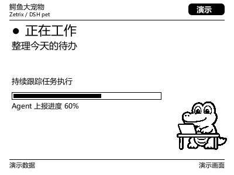

# 鳄鱼大宠物

**把 DeepSeek Harness 的实时状态推到桌角那块墨水屏上——抬头就能看见它在干活、在等你，还是要你拍板。**

一只小鳄鱼，跟着 DSH 的会话状态换动作。它是 **DeepSeek Harness 插件**：DSH 打开它就在，DSH 退出它就收尾，设置页就在 DSH 里，没有别的常驻程序。

`Windows 10 / 11 x64` · `v0.8.2` · `MIT` · DSH `>= 0.2.1-alpha.2` · ZECTRIX Note 4（400×300 单色）

<p align="center">
  
</p>

## 它能做什么

- **跟着 DSH 走**：DSH 启动时自动拉起，退出时释放设备并退出；DSH 被强杀也会在 10 秒内自检退出。
- **多任务并列**：1 个任务看详情，2 个任务各占两行，3 个以上分页显示；等你处理的永远排在第一页。
- **一眼看懂状态**：正在工作 `●`、等你处理 `！`、任务完成 `✓`、遇到问题 `×`、已停止 `■`。
- **一只鳄鱼六个动作**：待命、干活、等你、完成、出错、睡觉。
- **少闪、少打扰**：默认单色刷新（约 1–2 秒/帧），状态变化合并推送，两次间隔至少 3 秒；没任务时不占用设备。
- **该响的时候响**：进入「等你处理 / 任务完成」时响一次提示音，设备上双击确认键可静音。
- **右上角模式、右下角花絮**：花絮句子可自己换。

## 环境要求

1. **DeepSeek Harness** `>= 0.2.1-alpha.2`。
2. **ZECTRIX Note 4**，固件 **≥ 3.7.5**（更早的固件不支持本地推送）。刷机：[固件更新页](https://www.zectrix.com/firmware-updater.html)。
3. 设备与电脑在**同一局域网**，并在设备上打开「设置 → 网络同步 → 待机保持 Wi-Fi」。
   电脑上 mDNS 常被防火墙拦截，所以这里用**设备 IP 直连**。

## 安装

1. 在 DSH 里打开 **设置 → Plugins**，安装插件，填仓库地址：

   ```
   https://github.com/gator-university/zectrix-gator-pet
   ```

2. **重启 DeepSeek Harness**（插件和设置页都在启动时加载）。
3. 侧栏 **插件 → 已安装插件 → 鳄鱼大宠物**：填设备 IP，点「测试连接」，保存。
   约 2 秒后设备开始跟随。

> 插件自带 `bin/dsh-pet.exe`，不依赖 .NET / VC++ / Rust 运行时，也不会写 DSH 的数据目录。

## 使用

### 屏幕显示

| 情况 | 设备 |
| --- | --- |
| DSH 在线、没有任务 | 保持设备自己的界面，不占用、不刷新 |
| 有任务在跑 / 等你处理 | 占用并显示 |
| 任务完成 | 显示完成画面 5 秒，再回待命 |
| 跟随关闭 / 三击退出 | 立即释放，回设备默认界面 |

同一时刻只有一个程序能占用设备（固件限制）。

### 设备手势

| 手势 | 动作 |
| --- | --- |
| 单击确认 | 回首页 |
| 双击确认 | 静音 / 恢复提示音 |
| 三击确认 | 退出到设备普通界面（暂停跟随） |
| 单击上 / 下 | 在多任务之间切换、翻页 |

恢复跟随：设置页把「跟随」重新打开即可。

### 设置

设置页在 DSH 的 **插件** 页里，字段：

| 字段 | 说明 |
| --- | --- |
| 跟随 | 关闭后立即释放设备 |
| 模式 | 实时 / 平衡 / 安静 / 极简，控制细节刷新的合并间隔 |
| 提示音 + 音量 | 进入「等你处理 / 任务完成」时响一次，默认 90 |
| 设备 IP | 支持「测试连接」 |
| 刷新格式 | mono（默认，约 1–2 秒/帧）/ gray4（约 3.5 秒）/ gray16（约 5 秒） |
| 标题来源 | 默认只显示会话标题；切到 prompt 才会把提示词首行当标题 |

保存后约 2 秒生效，不用重启 DSH。

### 换花絮

编辑 `plugin/bin/quips.txt`，一行一句（≤20 字，`#` 开头的行忽略），重载插件生效。

### 换鳄鱼形象

把 `assets/gator/default/` 下的六个文件换成同尺寸（90×120 单色 PNG）同名的图即可，不用改代码：
`idle`、`working`、`waiting`、`done`、`error`、`sleep`。

## 排错

**「测试连接」失败 / 日志「没有发现可用设备」**
- 确认设备与电脑在同一网络，且「待机保持 Wi-Fi」已打开；
- 填设备 IP（`192.168.1.x`），不要依赖自动发现；
- 设备刚被别的程序占用时，等约 8 秒再试。

**设备连着但画面不变**
- 看日志 `%LOCALAPPDATA%\zectrix-dsh-pet\pet.log`；
- 确认 DSH 里确实有「正在工作 / 等你处理」的会话，且「跟随」是开着的。

**装完插件看不到设置页**
- 必须重启 DSH；
- 设置项在侧栏「插件」页的插件详情里，不是「设置 → 内置插件」那个只读列表。

**DSH 退出后宠物还在**
- 正常退出会自动清理；被强杀时 10 秒内自检退出。
- 若仍残留，任务管理器结束 `dsh-pet.exe`，下次启动 DSH 会重新拉起。

## 隐私

- 只**读** DSH 的会话日志，不写 DSH 数据；
- 默认只读状态、会话标题和 token 用量等元数据，**不读对话正文**；
- 等待确认时设备上只显示「有 1 个问题待确认」，不传提问原文；
- 日志默认只记会话短号和状态，不记标题；
- 与设备只走局域网 UDP，无云端、无账号；
- 设置页与宠物进程之间的本地 HTTP 接口只监听 `127.0.0.1`，带逐安装 token 和来源校验。

## 开发

```
cargo test --offline      # Rust 单测
cargo build --release     # 产物在 target\release\
cd plugin; npm test       # 插件侧单测
```

改了 Rust 代码后，把 `target\release\dsh-pet.exe` 复制到 `plugin\bin\` 再重装插件。

预览排版（不连设备）：`dsh-pet preview --demo working --out out\working.png`

## 归属

本项目是 [MuskCheng/zectrix-workbuddy-pet](https://github.com/MuskCheng/zectrix-workbuddy-pet) 的 fork：原项目跟随 WorkBuddy，本 fork 改为跟随 **DeepSeek Harness** 并改成插件形态。
原项目 MIT，Copyright (c) 2026 MuskCheng；本 fork 修改部分同 MIT，版权声明见 [LICENSE](LICENSE)。
